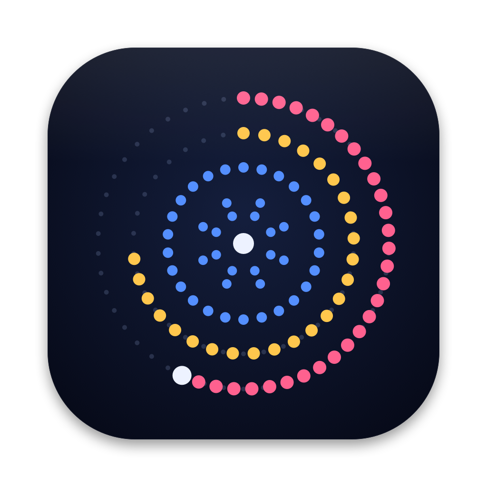

# Machine Mark for macOS

<p align="center">
  
</p>

An "About This Mac" drawn from your Mac's real specs, every mark made of round dots. Each ring is one fact about the computer, and you can knead the whole thing into a strip of rows and back.

A macOS port of [omarchy-machine-mark](https://github.com/erikrjohansson/omarchy-machine-mark) by Erik Johansson. The drawing engine (`web/sigil.js`) is the original's, run in a native window.

- **Hardware** (blue): a short line of dots per CPU core (performance cores heavy, efficiency cores light), a line per thread, a dot per GPU core, memory and disk as rows of large dots, a pulse per 10 Hz of the display.
- **Software** (yellow): a line per 10 Homebrew packages by install date (taller ones take more disk), a short run per 40 logged updates and installs (macOS, App Store, Homebrew), macOS's 8 accent colours with yours larger, a dot per app in Applications (the one you came from is larger), and a dot per launch agent or daemon (faint when it's off).
- **Age / Uptime** (pink): a dot per week since the Mac was set up (bigger for the weeks you updated more), a one-week dial since the last update, and a 24-hour dial for uptime.

The colours follow light/dark mode and your accent colour. The ring angles come from a seed of the computer name and hardware, so every Mac gets its own shape.

## Build and install

You need the Xcode command line tools (`xcode-select --install`).

```bash
./build.sh install    # builds, copies to /Applications, opens it
```

`./build.sh` only builds into `build/`, and `./build.sh run` builds and opens the window.

## Logo

The logo is the sigil boiled down to a few rings: the cores as short spokes, a blue ring for hardware, and yellow and pink rings filled part-way like the window's dials, all in round dots.

## Use

Open it like any app (Spotlight, Launchpad, Finder), from its menu bar icon, or with **⌃⌥⌘A** from anywhere. Closing the window leaves it in the menu bar, ready to open again.

| | |
|---|---|
| Drag sideways, click, <kbd>Space</kbd> | knead between sigil and strip |
| <kbd>←</kbd> <kbd>→</kbd> | sigil / strip |
| <kbd>↑</kbd> <kbd>↓</kbd>, hover | pick a ring; the footer explains it |
| <kbd>Esc</kbd>, <kbd>⌘W</kbd> | close |

To start it at login, add it in **System Settings → General → Login Items**. At login it starts quietly in the menu bar; opening it from Spotlight or ⌃⌥⌘A shows the window.

## What it reads

It only reads. It changes no settings, writes no files, and nothing leaves the Mac.

- `sysctl` (CPU, cores, uptime), `system_profiler` (GPU, displays, model), the GPU's load from IOKit
- memory statistics and the startup disk's capacity
- Homebrew's `Cellar` and `Caskroom` (install receipts and sizes)
- `/Library/Receipts/InstallHistory.plist` (macOS updates, App Store and package installs)
- the creation date of `/var/db/.AppleSetupDone` (when the Mac was set up)
- `/Applications`, `~/Applications`, and the LaunchAgents and LaunchDaemons folders

`MachineMark --dump` prints one reading as JSON.

## Layout

```
Sources/main.swift       window, menu bar item, hotkey, bridge to the page
Sources/Collector.swift  reads the Mac's facts
Sources/Palette.swift    colours from macOS's appearance and accent
web/sigil.js             the drawing engine (from the original, adapted)
web/card.js              the card: knead, hover, keys, words
icon/                    the app's logo and icon
```

## License

MIT, as the original. See LICENSE.
